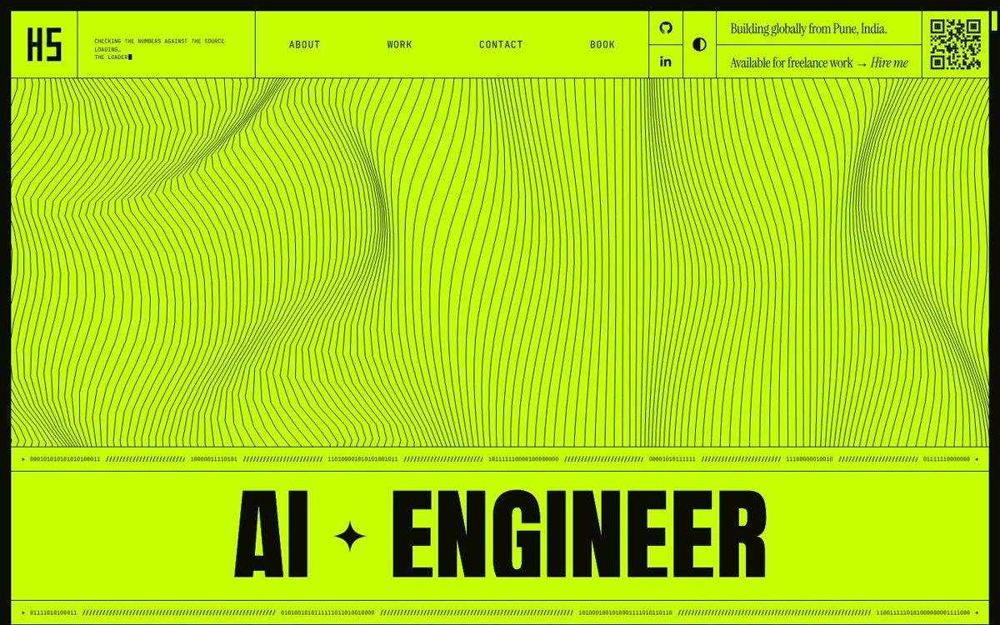
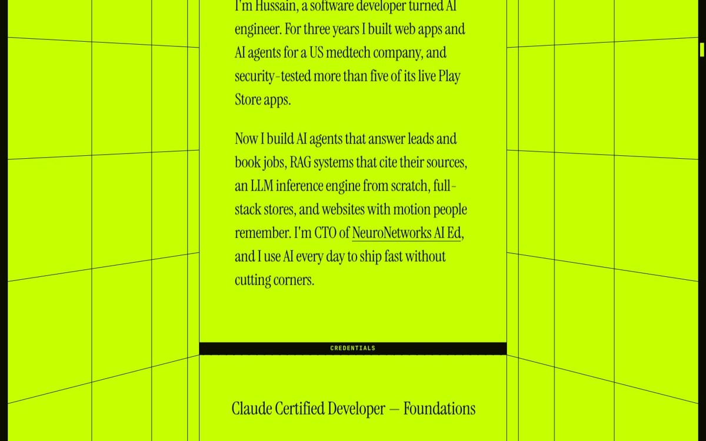
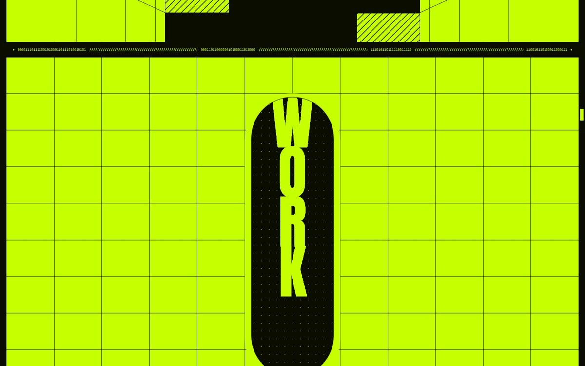
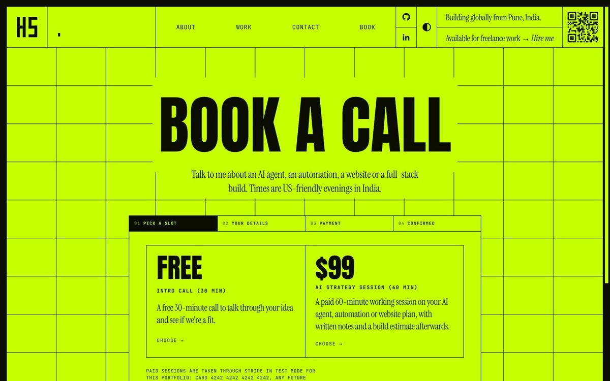
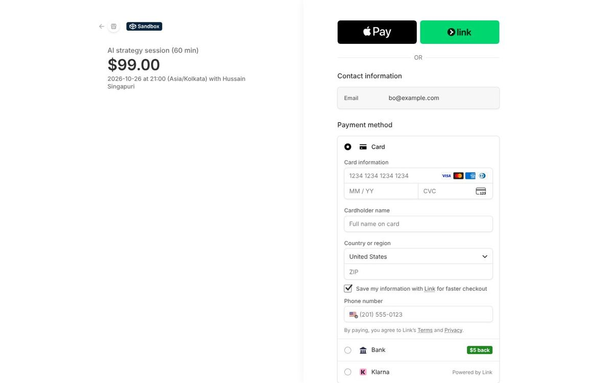
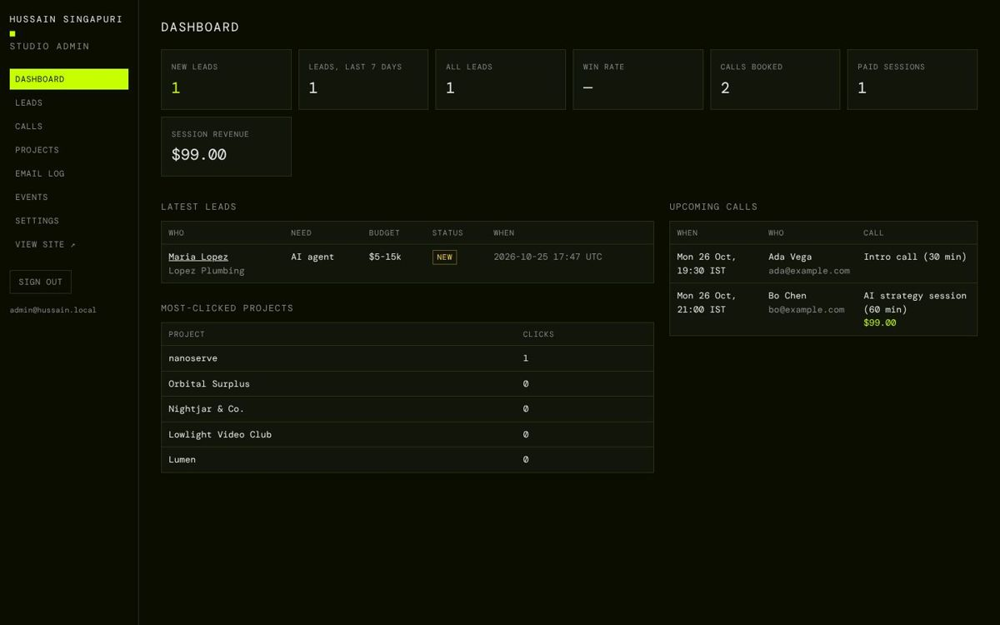
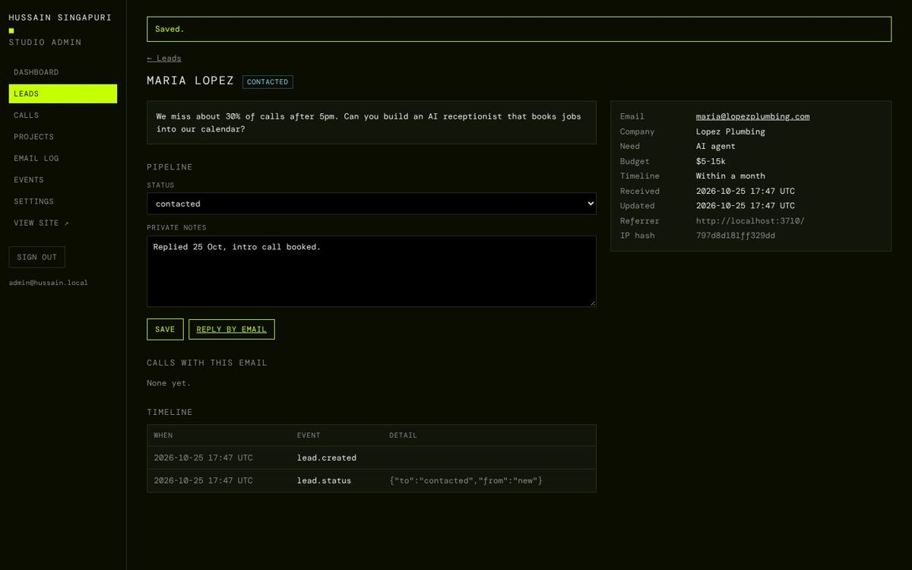

# Hussain Singapuri — AI Engineer

My portfolio: a scroll-driven, motion-heavy one-pager with a real full-stack backend behind it. Visitors can browse the work reel, send an enquiry into a lead pipeline, book a free intro call, or pay for an AI strategy session through Stripe. I run all of it from a studio admin.

**Live:** https://hussain-singapuri.vercel.app

> The paid session runs in Stripe **test mode**: card `4242 4242 4242 4242`, any future date, any CVC.



| | |
|---|---|
|  |  |
|  |  |
|  |  |

## The site

- **Two inks.** Volt `#C6FF00` paper and a green-tinted near-black ink. A permanent 1rem frame, 1px rules, and three type voices: Anton display, Instrument Serif reading, JetBrains Mono labels. A paper-mode toggle swaps in cream.
- **Intro.** An "HS" monogram drawn from bars. It is skippable and plays once per tab.
- **Header.** A typing console of AI-engineer jokes and a QR code that prints in bands.
- **Hero.** A Perlin wave field that reacts to the cursor, binary separators that spell words, and an **AI ✦ ENGINEER** headline whose letters roll.
- **About and credentials.** Parallax "corridor" lines behind the card, plus a credentials grid: 3 years at a US medtech company, 13 shipped projects, 5+ pen-tested Play Store apps, and Claude Certified Developer.
- **Work.** One scrubbed ScrollTrigger. A WORK keyhole zoom opens into a 3D tunnel of letters, and all 13 projects fly through in CSS 3D: websites, full-stack stores and AI systems. Each card links to the live site or the repo, and outbound clicks are counted.
- **Shipping code since 2022.** A timeline on a receding floor, with framed milestones you can throw and drag.
- **GO → LET'S SHIP.** A spring-grid call to action, then the enquiry form.
- **Accessibility.** Reduced-motion mode, a mobile menu, visible focus, and `aria-hidden` on decoration.

The front end is vanilla ES modules with GSAP 3.13 (ScrollTrigger, SplitText, DrawSVG) and Lenis. There is no framework and no build step.

## The backend

Node 20, one Vercel Function and Postgres (Neon). Local development and tests use PGlite, so nothing needs installing.

| Feature | How |
|---|---|
| **Content** | Projects live in Postgres and are edited, reordered or hidden from `/admin`. Every instance caches content and reloads when `content_version` changes. |
| **Enquiries** | Validation mirrored in the browser. A honeypot and a minimum fill time give bots a silent 202. A Postgres-backed rate limit is shared across all serverless instances. Each lead gets an owner email, an auto-reply and a `lead.created` event. |
| **Lead pipeline** | new → contacted → proposal → won/lost, with private notes, a per-lead timeline and CSV export. |
| **Booking** | Slots run Mon–Fri, 19:30 / 21:00 / 22:30 IST (US mornings). A **partial unique index** on the slot start means a held and a confirmed booking can never share a slot. |
| **Free intro call** | Confirmed straight away. An `.ics` calendar invite and an owner email go out. |
| **Paid strategy session ($99)** | The slot is held for 31 minutes and a Stripe Checkout Session is created. The booking is confirmed by whichever comes first: the return page (which checks the session with Stripe) or the signed webhook. Confirmation is idempotent. Cancelling at Stripe frees the slot immediately; an expired session releases it. |
| **Admin** | Session login (scrypt, SHA-256 session tokens, throttling). Covers the dashboard, leads, calls (cancel with an automatic Stripe refund), projects, email log with previews, events and a one-click Stripe webhook connect. |
| **Email** | Every message is logged to the database. Mail is actually sent through Resend when `RESEND_API_KEY` is set, including the calendar attachment. |
| **CRM** | `lead.created`, `booking.confirmed` and `booking.cancelled` events, HMAC-signed and POSTed to `CRM_WEBHOOK_URL` when it is set. |
| **SEO & security** | Server-rendered meta, JSON-LD (`Person`, `ProfessionalService`, `Service`, `ItemList`), sitemap, robots and real 404s. A nonce-based CSP, HSTS, X-Frame-Options and Origin checks on every write. |

## Run it

```bash
npm install
npm run dev     # http://localhost:3000 — PGlite in .data/, a built-in test card stands in for Stripe
npm test        # 10 end-to-end API tests against in-memory Postgres
```

Admin is at http://localhost:3000/admin. Locally the login is `admin@hussain.local` / `hussain-admin`; in production set `ADMIN_EMAIL` and `ADMIN_PASSWORD`.

| Env | Purpose |
|---|---|
| `DATABASE_URL` | Neon pooled connection string (PGlite when unset) |
| `STRIPE_SECRET_KEY` | `sk_test_…` (built-in test card when unset) |
| `ADMIN_EMAIL`, `ADMIN_PASSWORD` | Admin account, created or updated on boot |
| `OWNER_EMAIL` | Where lead and booking notifications go |
| `SESSION_SECRET` | Salt for IP hashes and the CRM webhook signature |
| `RESEND_API_KEY`, `EMAIL_FROM` | Optional: send email for real |
| `CRM_WEBHOOK_URL` | Optional: forward events to a CRM or automation tool |

## Layout

```
api/index.js           Vercel Function → server/server.js
server/
  server.js            router, static files, page rendering
  content.js           Postgres content + version cache (seed: data/content.json)
  leads.js             enquiry pipeline
  bookings.js          slots, holds, Stripe Checkout, webhook, .ics
  admin.js             /admin
  auth.js stripe.js email.js util.js seo.js security.js http.js db.js schema.sql
  shell.html           the page shell (served only through seo.js, with a CSP nonce)
public/                static front end (CSS, ES modules, images)
test/api.test.mjs
```

The motion system started from a study skeleton of a well-known creative-developer portfolio. The identity, copy, projects, images and the whole backend are my own.
